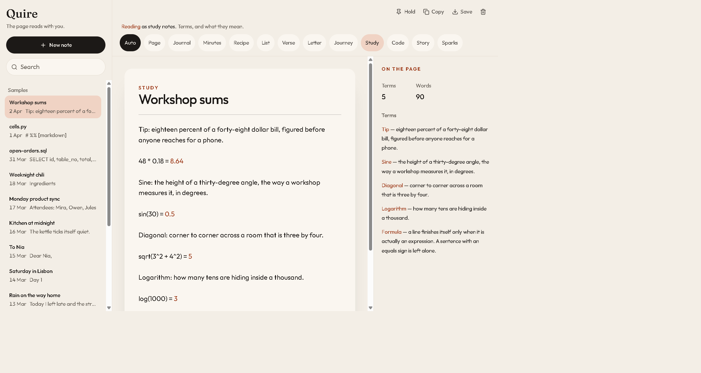
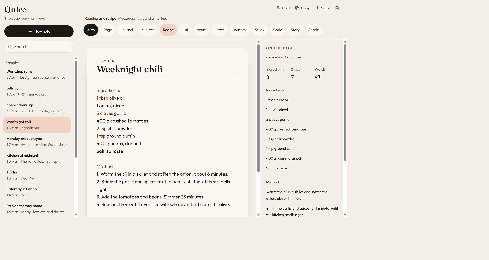
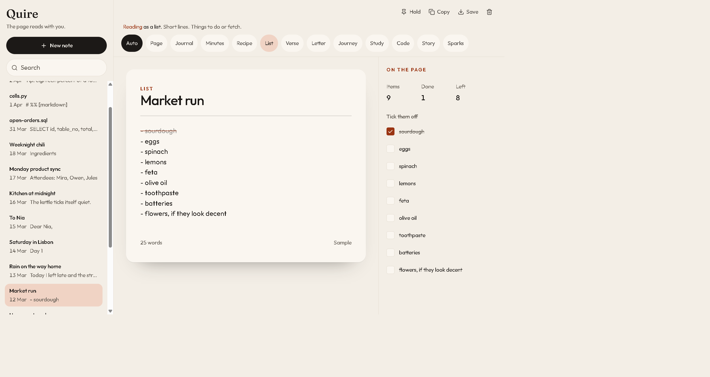
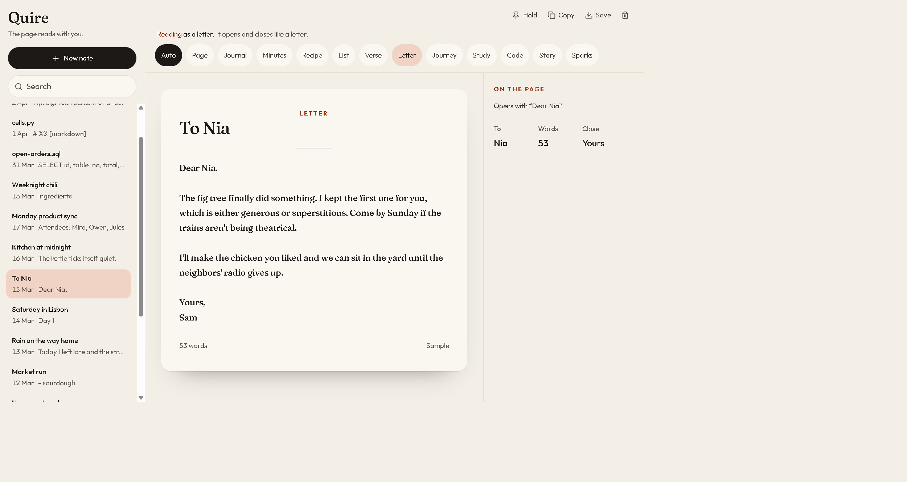
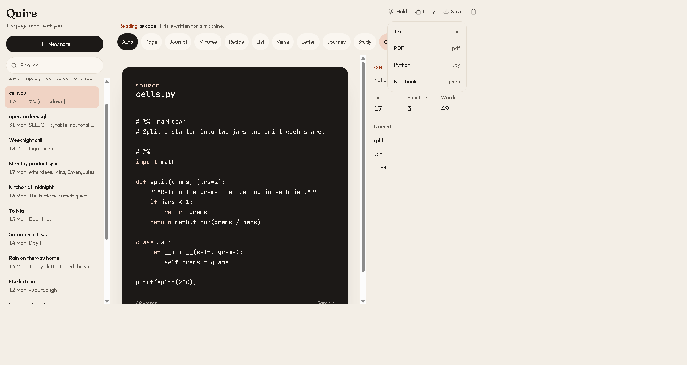

# Quire

A notes page that reads what you are writing and settles into that shape. A grocery list becomes checkboxes. A recipe becomes a kitchen card. A letter sets itself with a greeting and a close. Type `48 * 0.18 =` and the line finishes as `48 * 0.18 = 8.64`.

The reading happens in the browser, on each keystroke. Quire does not send the note to an API to decide what it is.



## What you can do

- Start a blank note and keep typing. The shape follows the writing until you hold it.
- Search the notebook, copy a note, or delete it.
- Tick items on a list. The side card counts what is done and what is left.
- Save the note as the file you actually wanted: text, PDF, a spreadsheet, or source code.
- Open the sample notebook and edit any page. Once you change it, it becomes yours.

## The page changes shape

Quire chooses a shape from the words on the page. The chip row shows the choice. **Auto** lets it keep listening. **Hold** pins the current shape so later sentences do not pull the page somewhere else. Click the same chip again to release it.

| Shape | It catches on when the page looks like |
| --- | --- |
| Page | A note that has not settled yet |
| Journal | A day kept in the first person |
| Minutes | Attendees, decisions, and owners |
| Recipe | Measures, heat, and a method |
| List | Short lines, one thing each |
| Verse | Line breaks doing the work |
| Letter | A greeting and a close |
| Journey | Times and places, in order |
| Study | Terms and what they mean |
| Code | Something written for a machine |
| Story | People, and someone speaking |
| Sparks | Fragments, questions, and what-ifs |







The card on the right is a reading of the same note: ingredients and steps, terms, a checklist, the person a letter is addressed to. On a phone that card opens from the page.

## Live math

A line finishes itself when it is an expression, not when it is a sentence that happens to contain an equals sign.

```text
48 * 0.18 =
sin(30) =
sqrt(3^2 + 4^2) =
log(1000) =
```

become

```text
48 * 0.18 = 8.64
sin(30) = 0.5
sqrt(3^2 + 4^2) = 5
log(1000) = 3
```

The result is marked on the page. If the number after the equals sign is wrong, Quire replaces it. `2 + 2 = 9` becomes `2 + 2 = 4`. A line of prose stays as you typed it.

Supported writing:

- `+` `-` `*` `/` `^`, and parentheses
- `sin` `cos` `tan`, in degrees
- `log` (base 10), `ln`, `sqrt`, `abs`
- `pi` and `e`

Only the line you are on is settled. The rest of the note is left alone.

**Workshop sums** in the sample notebook is a study page built around these lines. **Weeknight chili** ends with a scale line, `2 * 400 = 800`, so a recipe can carry a sum without turning into a calculator.

## Save the note as the file you meant

**Save** builds the file in the browser and downloads it. Every note can become text or a PDF. Some shapes add another file.

| You are writing | Save also offers |
| --- | --- |
| A list, recipe, minutes, journey, study notes, or sparks | A sheet (`.csv`), which opens in Excel or Google Sheets |
| Python, including a title like `cells.py` | A `.py` file, and a Jupyter notebook (`.ipynb`) |
| SQL, including a title like `open-orders.sql` | A `.sql` file |
| TypeScript or JavaScript, including a title like `debounce.ts` | That source file, keeping the extension you used |

Python cells split on `# %%`. A line `# %% [markdown]` becomes a markdown cell. The rest become code cells.

The PDF is a plain text document in Helvetica. Letters outside basic English are folded so the file still opens. For a note that depends on accents or other scripts, use **Text**.



## Sample notebook

A new Quire opens with pages already in shape. Editing a sample makes a copy that is yours; the sample flag comes off. Samples you have not edited pick up newer examples the next time the page loads. Notes you wrote yourself stay put.

| Sample | Shape | What it is for |
| --- | --- | --- |
| Workshop sums | Study | Finished expressions, including sine, a square root, and a log |
| cells.py | Code | A Python note that saves as `.py` and `.ipynb` |
| open-orders.sql | Code | A query that saves as `.sql` |
| Weeknight chili | Recipe | Ingredients, a method, and a scale line |
| Monday product sync | Minutes | Decisions and owners |
| Kitchen at midnight | Verse | Short lines and breath |
| To Nia | Letter | A greeting and a close |
| Saturday in Lisbon | Journey | A day told by the clock |
| Rain on the way home | Journal | A day in the first person |
| Market run | List | A checklist, with sourdough already ticked |
| How yeast works | Study | Terms and definitions |
| The last ferry | Story | A scene with people speaking |
| Names for the studio | Sparks | Questions and what-ifs |
| debounce.ts | Code | A TypeScript note that keeps the `.ts` name |

## Where the notes live

Notes stay in the browser you wrote them in. They are not in an account, and they are not copied to a server while you type. Clearing the site’s data, or opening Quire in another browser, starts a fresh notebook.

That is safer than sending every keystroke to an API. It is not encryption, and it does not stop a program that can already read an open page. **Save** downloads a file onto the machine you are using.
